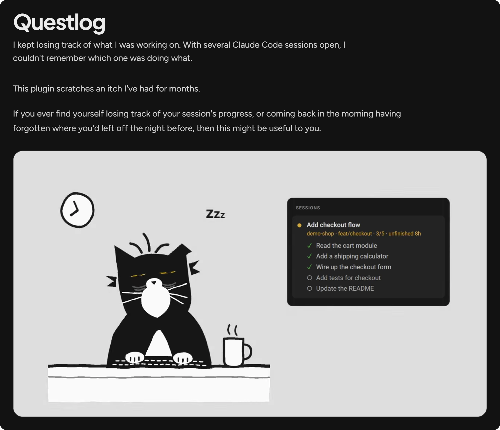
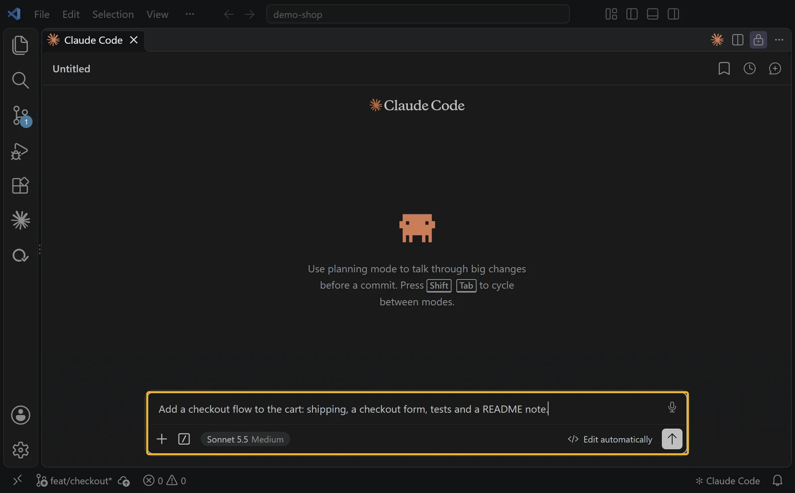
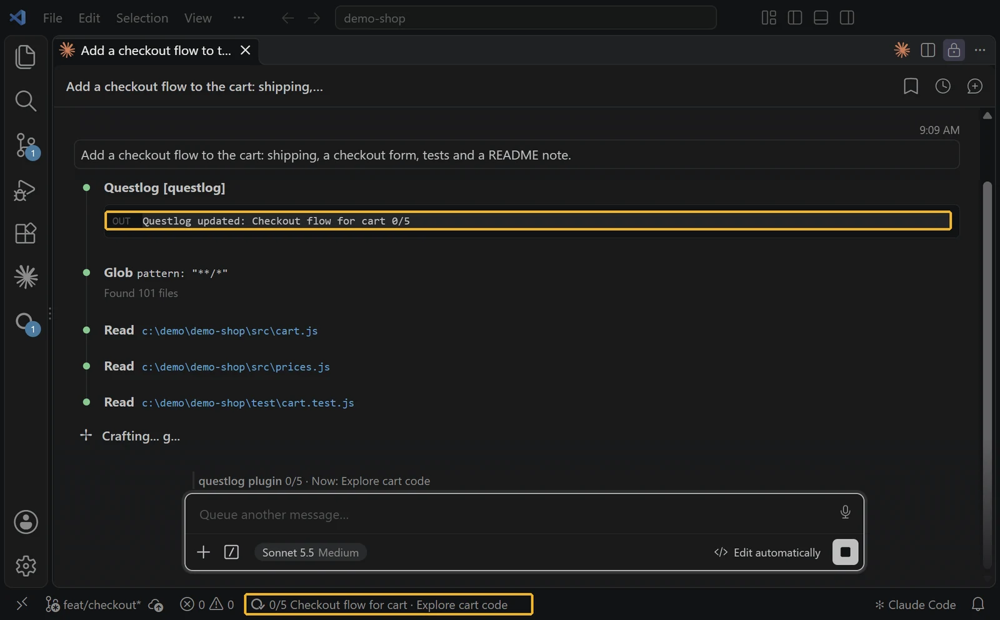
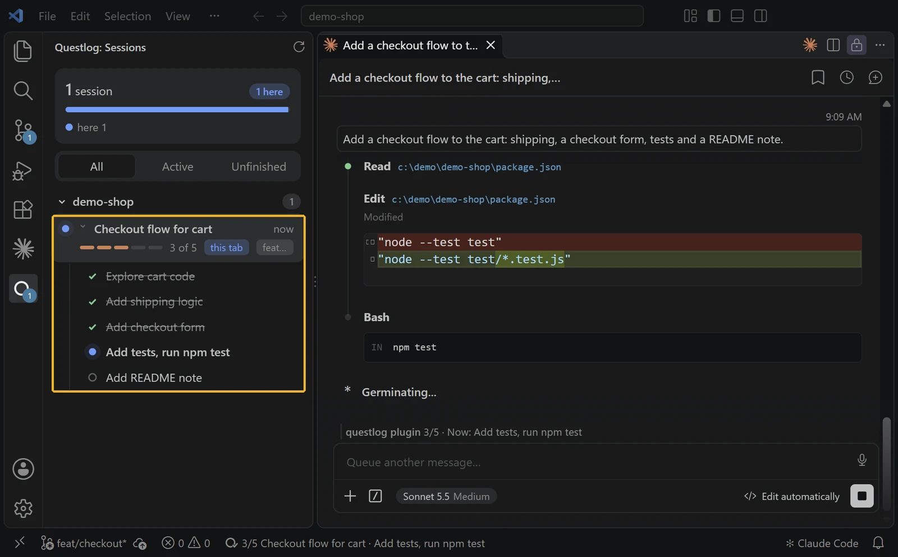
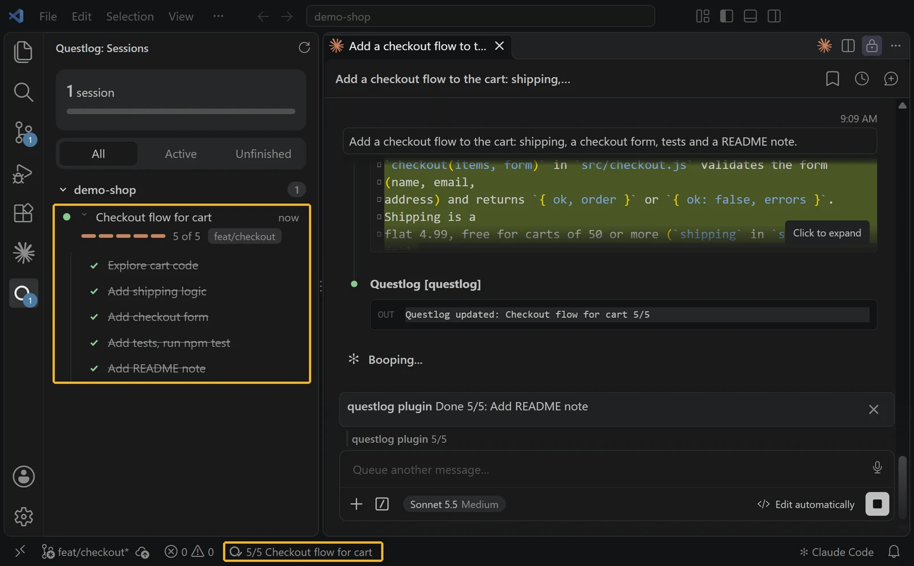
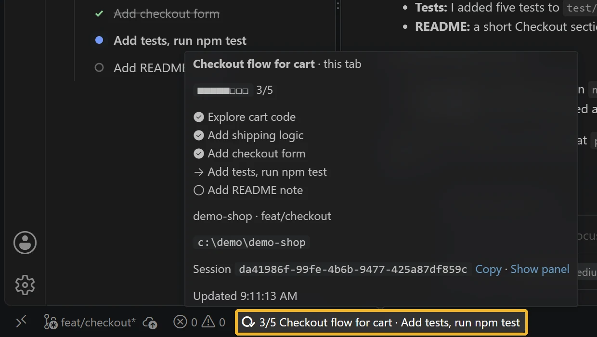
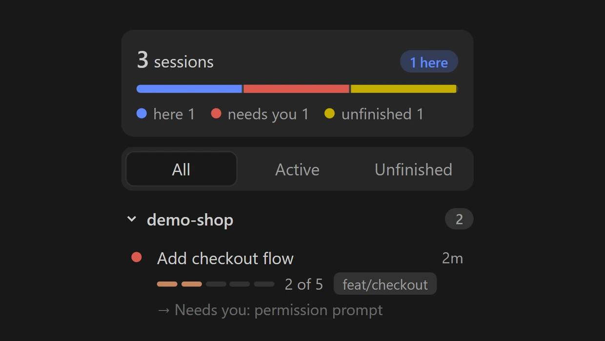
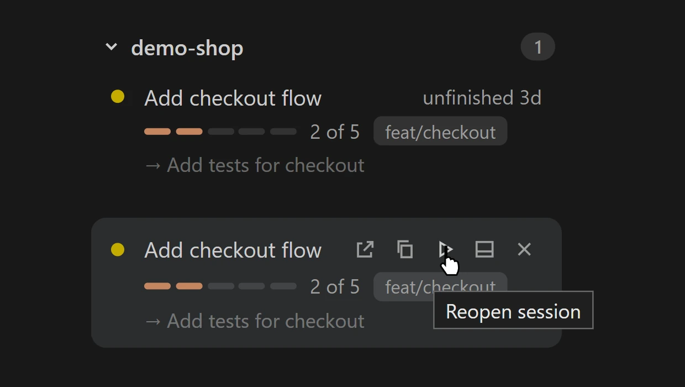

<a href="https://macdaraomurchu.com/products/questlog/"></a>

<a href="https://marketplace.visualstudio.com/items?itemName=macdara.questlog"></a> <a href="#install"></a> <a href="https://open-vsx.org/extension/macdara/questlog"></a> <a href="extension/LICENSE"></a>

[Product page](https://macdaraomurchu.com/products/questlog/) · [Install](#install) · [Features](#features) · [Changelog](CHANGELOG.md)

I kept losing track of what I was working on. With several Claude Code sessions open, I couldn't remember which one was doing what.

Questlog shows what each session is working on: its plan, the step it's on, and whether it's waiting for you.

## Install

Mod (in your terminal):

```
claude plugin marketplace add m4cd4r4/questlog
claude plugin install questlog@questlog
```

Extension: search "Questlog" in VS Code, or

```
code --install-extension macdara.questlog
```

It is also on [Open VSX](https://open-vsx.org/extension/macdara/questlog) for VSCodium and Cursor.

## What you'll see first

Start a new Claude Code session and give it a task with 3 or more steps, such as "Add a checkout flow with tests and a README note". A card shows up in the Questlog sidebar with the plan and ticks off each step. A quick question won't make a card.

---

## Watch a plan run

Claude writes a plan and ticks each step off. You see it without opening anything.

**1. Prompt**



**2. Plan**



**3. Progress**



**4. Done**



## Hover for the whole plan

Hover the Questlog item in the status bar to see every step, the repo and branch, the folder, and the session ID with a Copy link.



## Spot a waiting session

If a session is stuck on a permission prompt, it gets a red dot and the reason. You don't have to wonder why nothing has moved.



## Pick up where you stopped

Come back in the morning, hover the unfinished session and click play. It reopens in a Claude tab.



## Why not Claude Code's own session list?

Claude Code can already list your running sessions and tell you if one is waiting (`claude agents`). Questlog adds what each one is doing: its plan, the step it's on, and how far it has got. A session you leave unfinished stays in the sidebar for up to 7 days, with a play button to open it again.

---

## Features

### See every session

- Every live session in one sidebar, grouped by repo.
- Each card shows the plan, a progress bar and the step it is on.
- A summary strip counts sessions here, running, needing you, unfinished and idle.
- All, Active and Unfinished filters.
- The status bar shows the stage of the session in the active tab.
- Hovering a session lists every step. Clicking a step shows its detail.
- Each session has a details tab.
- Hover a card and click x to hide it. It comes back if the session updates.
- The sidebar uses your VS Code theme colours, so it follows dark, light and high contrast.

### Know what needs you

- A session waiting on you gets a red card with the reason, for example a permission prompt.
- A session whose Claude process has ended shows as unfinished straight away.
- A session with plan steps left that goes quiet shows as unfinished (amber, "unfinished 3d").
- A session cut off partway through a turn says "interrupted 3h".
- A card closes only when every step it still has open is accounted for: finished, or not needed with a reason.
- Another session can close a card that way (`questlog_close`). You can too: hover the card and click Close. The card names who closed it and each reason, and comes back if its own session reports again. Undo close takes it back.
- A step can name a path that proves it done, such as a build output or a removed worktree. Once its session is gone, the card closes itself when every open step checks out ("Closed by check").

### Pick up where you stopped

- Unfinished sessions get a play button. One click reopens them in a Claude tab.
- If the session's folder isn't open in this window, it copies the resume command instead.
- A session active in the last 15 minutes asks first, in case it is running in another window.
- Unfinished sessions stay for 7 days. A reopened session gets its plan back.
- Parent plans: with a worktree registry, the sidebar shows each plan above the sessions of its repo.
- Restart note: a freshly started session is told the contents of `restart-note.md`, and the sidebar shows it at the top.

### In the terminal

- The tab title shows the stage and plan.
- A status line above the prompt shows the same. You can turn it off.
- Each finished step shows a toast.
- `/sessions` lists every live session.
- `/questlog` prints the plan, stage, done, now and todo of the current session.
- `/questlog-stats` prints this month: sessions, how they ended, steps done, by repo. The sidebar shows the same under "This month".
- A short session ID joins the tab title when two sessions share a title.

---

## Works in

| Where | What you get |
|---|---|
| Claude Code in a terminal | The mod alone: tab title, status line, toasts, `/sessions`, `/questlog`, `/questlog-stats` |
| VS Code | The extension adds the sidebar, status bar item and reopen |
| Cursor, VSCodium | The extension is on Open VSX. Untested |
| claude.ai/code on the web, desktop app, JetBrains | Untested |
| claude.ai chat | No |

The mod works without the extension. The extension shows nothing without the mod.

---

## Technical

Questlog is two parts. The **mod** (a Claude Code plugin, in `mod/`) gives Claude a `questlog` tool, sets the tab title, shows a status line, toasts each finished step, adds `/sessions`, `/questlog` and `/questlog-stats`, and deletes old rows. The **VS Code extension** (in `extension/`) adds the sidebar and the status bar item.

### Settings

Mod options:

| Option | Default | What it does |
|---|---|---|
| `status_line` | `true` | Show the stage and plan in the status line above the prompt |
| `session_tag` | `clash` | Session ID in the tab title: `clash` (only when another live session has the same title), `always` or `never` |

Extension settings:

| Setting | Default | What it does |
|---|---|---|
| `questlog.useAgentView` | `true` | Ask `claude agents --json` which sessions are running |
| `questlog.agentViewSeconds` | `10` | How often to ask, in seconds. Minimum 5 |
| `questlog.registryPath` | empty | Worktree registry the parent plans are read from. Empty means `workspaces/registry.json` in the Claude config folder |
| `questlog.resumeCommand` | `git worktree add ../{slug} -b {slug}` | Command copied when you click a plan slice that has no worktree yet. `{slug}` becomes the slice's slug |

### Slash commands

| Command | What it does |
|---|---|
| `/sessions` | List every live Claude session: repo, branch, plan, stage, now |
| `/questlog` | Print the plan, stage, done, now and todo of this session |
| `/questlog-stats` | This month: sessions, how they ended, steps done, by repo |

### Data

One JSON file per session in `~/.claude/questlog/` (or `$CLAUDE_CONFIG_DIR/questlog/`).

| Session | Quiet for | Shown as | Dropped after |
|---|---|---|---|
| Finished, or no plan steps yet | 6 hours | idle | 24 hours |
| Plan steps left | 6 hours | unfinished (amber, "unfinished 3d") | 7 days |
| Tab closed with steps left | at once | one collapsed line per repo | 24 hours |

A close lives in `<session id>.close` beside the row.

Old rows are deleted. Once a day, at the start of a session, the mod deletes each row and its `.close` when the session last updated 7 days ago (finished, closed, or no plan steps) or 30 days ago (steps left). First it writes one line about the row to `ledger/YYYY-MM.jsonl` in the same folder: plan, steps done of total, repo, first and last update, and how it ended. `/questlog-stats` reads the ledger. Nothing else in the folder is deleted.

Hidden sessions live in `dismissed.json` in the same folder. Sessions continued with /clear, finished sessions in closed tabs, and sessions that never got a message or a plan are hidden.

### What it reads and sends

Reads and writes `~/.claude/questlog/`, and deletes rows in it past the times above. Runs `git` in the session's directory to find the repo and branch. The extension also runs `claude agents --json` and reads the worktree registry if one exists. Neither part makes a network request itself.

### Moving from Session Compass

On first run, Questlog copies your `~/.claude/session-compass` data and `sessionCompass.*` settings across once, so existing sessions keep their plans. The old folder stays in place. Mod options are not copied, so set `status_line` and `session_tag` again if you changed them. Then remove the old plugin and extension.

### Uninstall

```
claude plugin uninstall questlog@questlog
claude plugin marketplace remove questlog
code --uninstall-extension macdara.questlog
```

Then delete `~/.claude/questlog/` if you don't want the session files.

<details>
<summary>How it works, in detail</summary>

### How it works

1. The mod tells Claude to call `questlog` when a task has 3 or more steps, when a step starts or finishes, and when the plan changes. A call carries a 3 to 6 word plan name and the whole step list, each step marked `done`, `now` or `todo`.
2. Each call updates the tab title, the status line, and the session's JSON file.
3. The extension watches that folder and shows each session as a card in the Sessions view.

### Session IDs in tab titles

Every Claude Code session has an ID. Questlog uses the first six characters, like `e708ab`, to keep tabs and sessions matched.

**Why it is there.** The footer finds your session by matching the tab's label to the title Questlog saved for it. If two sessions share a title, the footer can show the wrong one's plan. A short ID in the title tells them apart. It also helps when you are chasing a runaway process and need to match a tab to a session ID.

**When it shows.** By default, only on a clash: when another live session already has the same title, the later one is tagged, like `[e708ab] 3/5 Add checkout flow`. Otherwise titles are left alone. A session that has the tag keeps it.

**The setting.** With `session_tag` set to `never`, two sessions with the same title can share a footer.

**Where else to find it.** The full ID is in a session's details tab, in the footer hover card, and behind the card's Copy button.

### Parent plans

If a worktree registry exists (`workspaces/registry.json` in the same Claude folder, or the `questlog.registryPath` setting), the sidebar shows each parent plan above the sessions of its repo: entries that share a `plan`, ordered by `wave`. A plan shows while it has two or more slices, at least one still open, and one touched in the last 14 days or with a worktree on disk. A repo with a plan but no live session gets a group of its own, so the plan stays reachable.

Each open slice is one of: working (worktree on disk), blocked, due (its `gate_date` has passed), held (a `gate_reason` with no date or a date ahead, or a `depends_on` slug still open), or ready. Done slices are counted in the plan's summary, not listed. Open a slice and press **Copy resume** to copy its resume action: the worktree path for a working slice, else `questlog.resumeCommand` with `{slug}` filled in. A working slice also has **Open worktree**, which opens its folder in a new window. The extension only reads the registry; it never writes it.

### Restart note

If `restart-note.md` exists in the same folder, a freshly started session (not one continued by `/clear` or a compact) is told its contents and mentions it in the first reply. The sidebar shows it at the top.

</details>

<sub>Develop: `cd extension && npm install && npm test && npm run package` · MIT, see [extension/LICENSE](extension/LICENSE)</sub>
