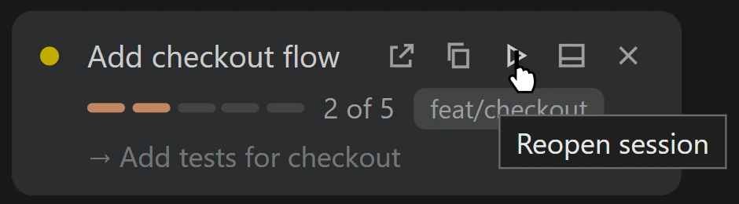

# Questlog

A sidebar for the parallel Claude Code sessions you have running: which repo, which branch, what plan, which step.

Click the Questlog icon in the Activity Bar to open **Sessions**. Sessions are grouped by repo and shown as cards. Each shows its plan, a progress bar, and the step it is on, with a summary strip and All, Active and Unfinished filters above them. The status bar shows the stage of the session in the active tab.

## Pick up where you stopped

Sessions with plan steps left get a play button. One click reopens the session in a Claude tab.



## Needs the mod

This extension only reads what the **questlog mod** writes to `~/.claude/questlog/` (or `$CLAUDE_CONFIG_DIR/questlog/`). Without the mod the view is empty. Install the mod from your terminal:

```
claude plugin marketplace add m4cd4r4/questlog
claude plugin install questlog@questlog
```

## Details

- A session appears once Claude calls the `questlog` tool, which the mod adds and asks Claude to use for tasks of 3 or more steps.
- A finished session, or one with no plan steps yet, that goes quiet for 6 hours is marked idle and dropped after 24 hours. One with plan steps left that goes quiet shows as unfinished (amber) and stays for 7 days. Ended sessions, and sessions that never got a message or a plan, are hidden.
- Hover a card and click x to hide it. It comes back if the session updates.
- If `restart-note.md` exists in the same folder, it is shown at the top of the view.
- The **Refresh** button re-reads the folder.
- No network requests. The extension only reads local files.

Source and mod: [github.com/m4cd4r4/questlog](https://github.com/m4cd4r4/questlog). Licence: MIT.
